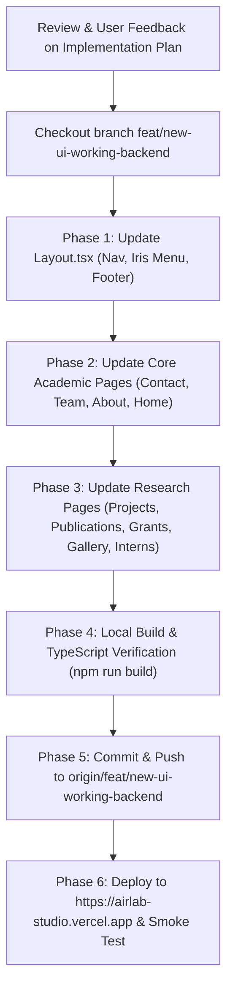

# AIR Lab Studio UI Terminology Alignment Implementation Plan

> [!IMPORTANT]
> **Branch & Deployment Safety**: All changes will be executed strictly on the new UI branch [`feat/new-ui-working-backend`](file:///c:/vibes/Air%20Lab) and deployed to **`https://airlab-studio.vercel.app`**. The production branch `main` and production link `https://airlab-website-peach.vercel.app` remain 100% untouched.

---

## 1. Executive Summary

During the initial design sprint, the Studio Unlmtd portfolio engine was integrated into the new branch. While this brought modern WebGL animations, liquid gradient titles, and smooth reveals, several agency placeholders (e.g. *"Directorate"*, *"Founders"*, *"Give us a limit"*, *"Two minds. One direction"*, *"Work / Services / Studio"*) were retained verbatim. 

As requested by the AIR Lab client and lab leads, this plan maps every misplaced agency phrase to the exact institutional and academic terminology curated in the `main` branch, while preserving the new UI's visual design, animations, and responsive layout.

---

## 2. Terminology Mapping & Audit by File

### 2.1 [Contact.tsx](file:///c:/vibes/Air%20Lab/src/pages/Contact.tsx)

| Location / Element | Current Studio UI Agency Copy | Curated `main` Branch Copy | Rationale |
| :--- | :--- | :--- | :--- |
| **Section Label** | `PRINCIPAL INVESTIGATORS & LAB DIRECTORATE` | `COMMUNICATIONS & INQUIRIES` | Aligns with official lab inquiry channels; removes "Directorate". |
| **Page Title (H1)** | `GIVE US A LIMIT.` | `Connect with AIR Lab` (or `Contact AIR Lab`) | Restores institutional invitation to research collaboration. |
| **Intro Subtitle** | *"Direct access to our Principal Investigators and Research Leads..."* | *"Department of Computer Science & Information Technology (CSIT), NED University of Engineering & Technology."* | Provides university institutional affiliation. |
| **Form Field Label** | `Your project, grant, or limit` | `Project, Grant, or Research Scope` | Removes "limit". |
| **Submission Note** | `
Dispatched directly to the AIR Lab Directorate...
` | `
Dispatched directly to the AIR Lab Coordination Desk at NED University.
` | Eliminates "Directorate" in favor of coordination team. |
| **Contact Aside / Card** | Direct email only | Official Email: `contact@airlab.neduet.edu.pk` Department Phone: `9221-99261261 Ext: 2399` Location: Department of CSIT, NED University | Adds official phone extension and primary contact address from `main`. |

---

### 2.2 [Team.tsx](file:///c:/vibes/Air%20Lab/src/pages/Team.tsx)

| Location / Element | Current Studio UI Agency Copy | Curated `main` Branch Copy | Rationale |
| :--- | :--- | :--- | :--- |
| **Header Badge** | `THE TEAM FACULTY, FELLOWS & ALUMNI` | `RESEARCH FACULTY & SCHOLARS` | Matches `main` badge standard. |
| **Page Title (H1)** | `THE PEOPLE BEHIND IT.` | `Our Research Team` (or `RESEARCH FACULTY & SCHOLARS`) | Curated academic title. |
| **Subtitle** | *"Principal Investigators, Faculty Supervisors..."* | *"Faculty leads, research interns, and scholars driving foundational regional AI, computer vision, and autonomous robotics at NED University."* | Curated lead-in copy. |
| **Filter Tabs** | `All`, `Faculty & PIs`, `Active Fellows`, `Alumni` | `All`, `Faculty & PIs`, `Research Interns`, `Alumni Interns` | Replaces "Active Fellows" with standard lab designation "Research Interns". |
| **Faculty Section** | `founders-intro` / `founder-name` classes and labels | `Faculty & Principal Investigators` | AIR Lab is led by university faculty and PIs, not corporate "Founders". |
| **Interns Section** | `ACTIVE RESEARCH FELLOWS` | `Research Interns & Scholars` | Exact section title from `main`. |
| **Alumni Section** | `GRADUATED FELLOWS` | `Previous Research Interns & Alumni` | Curated archive terminology from `main`. |

---

### 2.3 [About.tsx](file:///c:/vibes/Air%20Lab/src/pages/About.tsx)

| Location / Element | Current Studio UI Agency Copy | Curated `main` Branch Copy | Rationale |
| :--- | :--- | :--- | :--- |
| **Top Badge** | `THE LAB NED UNIVERSITY · DEPARTMENT OF CSIT` | `NED UNIVERSITY · CSIT` | Clean institutional badge. |
| **Page Title (H1)** | `THE MINDS. UNLMTD.` | `About AIR Lab` | Replaces commercial agency slogan with official lab title. |
| **Subheading** | *"Artificial Intelligence & Robotics Lab is NED University's premier center..."* | *"Pioneering artificial intelligence research, academia-industry innovation, and capacity building at NED University of Engineering & Technology."* | Curated summary statement from `main`. |
| **Foundational Story** | *"Why We Built AIR Lab / Academic depth. One shared conviction."* | **Paragraph 1**: *Vision & Foundation: Advancing Cutting-Edge AI & Translating Innovation* **Paragraph 2**: *Academia & Industry Bridging: Practical Solutions & Capacity Building* **Paragraph 3**: *Regional Impact & Sovereign AI* | Incorporates the 3 client-approved core institutional narrative cards from `main`. |
| **Core Pillars** | Generic process steps (01 Define, 02 Curate, 03 Train, etc.) | **The 4 Pillars of Excellence**: 1. *Theoretical Exploration & Applied AI* 2. *Bridging Academia & Industry* 3. *Robust, Ethical & Explainable Systems* 4. *Capacity Building & National Ecosystem* | Restores the 4 pillars carefully curated with lab leads. |

---

### 2.4 [Home.tsx](file:///c:/vibes/Air%20Lab/src/pages/Home.tsx)

| Location / Element | Current Studio UI Agency Copy | Curated `main` Branch Copy | Rationale |
| :--- | :--- | :--- | :--- |
| **Hero Title (H1)** | `THE LIMITS. WE BREAK THEM.` | `Where Intelligence Meets Engineering.` | Approved AIR Lab signature motto from `main`. |
| **Hero Subtitle** | Agency pitch text | *"Artificial Intelligence Research Lab at NED University of Engineering & Technology — driving foundational research in Computer Vision, Autonomous Systems, and Multilingual AI."* | Approved lab mission statement. |
| **Leadership Section (H2)** | `TWO MINDS. ONE DIRECTION.` / `THE PEOPLE MAKING THE CALLS` | `Faculty Leadership & Principal Investigators` | Removes Studio Unlmtd founder cliché; reflects actual faculty governance. |
| **Core Research Areas** | Raw capability bullets | **6 Core Research Thrusts**: 1. *Foundational Models & NLP (Urdu & Multilingual)* 2. *Autonomous Robotics & Edge AI* 3. *Intelligent Health & Diagnostics* 4. *Smart Agriculture & Precision Farming* 5. *Edge Computing & Embedded AI (TinyML)* 6. *Generative AI & Multimodal Synthesis* | Full restoration of the 6 formal research areas defined with lab leads. |
| **News / Updates** | Generic agency entries | Curated lab updates (Urdu LLM, Fall Admissions, UAV Benchmarks, Performer Honors, National Infrastructure Grants) | Restores authentic institutional announcements. |

---

### 2.5 [Projects.tsx](file:///c:/vibes/Air%20Lab/src/pages/Projects.tsx)

| Location / Element | Current Studio UI Agency Copy | Curated `main` Branch Copy | Rationale |
| :--- | :--- | :--- | :--- |
| **Page Title (H1)** | `Work.` | `Applied AI Systems & Projects` (or `Projects Catalog`) | Replaces 1-word agency header with formal research catalog header. |
| **Header Badge** | `PORTFOLIO · NED UNIVERSITY` | `FEATURED WORK & BENCHMARKS` | Formal benchmark badge. |
| **Filter Categories** | `['all', 'Ongoing', 'Finished', ...tags]` | Primary categories: `['All', 'Funded', 'R&D', 'Undergraduate', 'Postgraduate']` + Status filters (`Ongoing`, `Finished`) | Preserves both academic grant/education tiers and active status filters. |

---

### 2.6 [Publications.tsx](file:///c:/vibes/Air%20Lab/src/pages/Publications.tsx)

| Location / Element | Current Studio UI Agency Copy | Curated `main` Branch Copy | Rationale |
| :--- | :--- | :--- | :--- |
| **Page Title (H1)** | `WHAT WE PUBLISH.` | `Research Papers & Publications` | Academic publication masthead. |
| **Header Badge** | `PUBLICATIONS & RESEARCH OUTPUT` | `PEER-REVIEWED SCIENTIFIC OUTPUT` | Formal peer-review badge. |
| **Blog / Dispatch Section** | `DISPATCHES & FIELD NOTES` | `Research Blogs & Dispatches` with badge `Articles & Technical Notes` | Exact section title and badge from `main`. |

---

### 2.7 [Grants.tsx](file:///c:/vibes/Air%20Lab/src/pages/Grants.tsx)

| Location / Element | Current Studio UI Agency Copy | Curated `main` Branch Copy | Rationale |
| :--- | :--- | :--- | :--- |
| **Page Title (H1)** | `OUTCOMES & FUNDING.` | `Research Funding & Sponsored Grants` | Formal grant ledger title. |
| **Header Badge** | `SERVICES / OUTCOMES` | `RESEARCH FUNDING & GRANTS` | Eliminates agency "Services" phrasing. |
| **Investigator Fallback** | `grant.leadInvestigator \|\| 'AIR Lab Directorate'` | `grant.leadInvestigator \|\| 'Faculty Principal Investigator'` | Completely removes "Directorate". |
| **Subheading** | Generic pitch text | *"Official government research programs, Sindh Higher Education Commission awards, national technology grants, and international fellowships supporting computational intelligence at AIR Lab."* | Curated sponsor description from `main`. |

---

### 2.8 [Layout.tsx](file:///c:/vibes/Air%20Lab/src/components/Layout.tsx) (Navigation, Iris Menu & Footer)

| Location / Element | Current Studio UI Agency Copy | Curated `main` Branch Copy | Rationale |
| :--- | :--- | :--- | :--- |
| **Iris Menu Word 01** | `WORK` | `RESEARCH` (or `PROJECTS`) | Academic portfolio categorization. |
| **Iris Menu Word 02** | `SERVICES` | `PUBLICATIONS` | Replaces agency "Services" with scholarly output. |
| **Iris Menu Word 03** | `STUDIO` | `FACULTY & LAB` (or `ABOUT`) | Replaces design "Studio" with university faculty and lab. |
| **Iris Menu Word 04** | `CONTACT` | `CONNECT` (or `COORDINATION`) | Connects with fellowship intake and research inquiry desk. |
| **Menu Sub-lines** | *"Two minds. One direction..."* / *"Give us a limit..."* | *"Where Intelligence Meets Engineering — Faculty, Researchers & Sovereign AI."* / *"Connect with AIR Lab — Fellowships, Collaborations & Academic Inquiries."* | Purges remaining agency mottos. |
| **Footer CTA** | `GIVE US A LIMIT.` | `CONNECT WITH AIR LAB.` | Professional institutional call to action. |
| **Footer Column 1** | `STUDIO & LAB` | `DEPARTMENT & LAB` | Reflects Department of CSIT affiliation. |
| **Footer Bottom Ribbon** | `100% HUMAN. 100% AI. 200% UNLMTD.` | `Department of CSIT · NED University of Engineering & Technology` | Institutional footer line. |

---

### 2.9 Other Pages ([Gallery.tsx](file:///c:/vibes/Air%20Lab/src/pages/Gallery.tsx), [Interns.tsx](file:///c:/vibes/Air%20Lab/src/pages/Interns.tsx), [Collaborations.tsx](file:///c:/vibes/Air%20Lab/src/pages/Collaborations.tsx), [Performers.tsx](file:///c:/vibes/Air%20Lab/src/pages/Performers.tsx))

- **[Gallery.tsx](file:///c:/vibes/Air%20Lab/src/pages/Gallery.tsx)**: Title changes from `Lab.` to `Laboratory Gallery & Media`; badge `LABORATORY MILESTONES & MEDIA`.
- **[Interns.tsx](file:///c:/vibes/Air%20Lab/src/pages/Interns.tsx)**: Title changes from `RESEARCH FELLOWS.` to `Research Interns & Scholars`; sub-badge `STUDENT RESEARCH FELLOWSHIPS`.
- **[Collaborations.tsx](file:///c:/vibes/Air%20Lab/src/pages/Collaborations.tsx)**: Title changes from `ALLIANCES & PARTNERS.` to `Research Alliances & Partners`.
- **[Performers.tsx](file:///c:/vibes/Air%20Lab/src/pages/Performers.tsx)**: Title changes from `TOP PERFORMERS.` to `Performer of the Month`; badge `STUDENT SPOTLIGHT & HONORS`.

---

## 3. Step-by-Step Execution Plan

1. **Phase 1: Navigation & Layout Alignment**
   - Update `MENU_ITEMS` in [`Layout.tsx`](file:///c:/vibes/Air%20Lab/src/components/Layout.tsx) (`RESEARCH`, `PUBLICATIONS`, `FACULTY & LAB`, `CONNECT`).
   - Clean up footer CTA and bottom copyright bar.
2. **Phase 2: Faculty, Contact & About Pages**
   - Align [`Contact.tsx`](file:///c:/vibes/Air%20Lab/src/pages/Contact.tsx) headers, remove all instances of "Directorate" and "Give us a limit", and insert official phone extension and desk contact info.
   - Align [`Team.tsx`](file:///c:/vibes/Air%20Lab/src/pages/Team.tsx) tabs (`Faculty & PIs`, `Research Interns`, `Alumni Interns`) and replace "Founders" phrasing.
   - Align [`About.tsx`](file:///c:/vibes/Air%20Lab/src/pages/About.tsx) to restore the 3 official narrative sections and the 4 Pillars of Excellence.
   - Align [`Home.tsx`](file:///c:/vibes/Air%20Lab/src/pages/Home.tsx) signature motto (`Where Intelligence Meets Engineering`) and the 6 Core Research Thrusts.
3. **Phase 3: Portfolio, Publications & Grants**
   - Update [`Projects.tsx`](file:///c:/vibes/Air%20Lab/src/pages/Projects.tsx) category tabs and title.
   - Update [`Publications.tsx`](file:///c:/vibes/Air%20Lab/src/pages/Publications.tsx) and [`Grants.tsx`](file:///c:/vibes/Air%20Lab/src/pages/Grants.tsx) fallbacks and badges.
   - Update [`Gallery.tsx`](file:///c:/vibes/Air%20Lab/src/pages/Gallery.tsx), [`Interns.tsx`](file:///c:/vibes/Air%20Lab/src/pages/Interns.tsx), [`Collaborations.tsx`](file:///c:/vibes/Air%20Lab/src/pages/Collaborations.tsx), [`Performers.tsx`](file:///c:/vibes/Air%20Lab/src/pages/Performers.tsx).
4. **Phase 4: Quality & Integrity Verification**
   - Run `npm run build` locally to guarantee zero TypeScript or bundler errors.
   - Test locally with preview server to ensure liquid animations, gradient typography, and WebGL effects work smoothly with the new wording.
5. **Phase 5: Deployment & Validation**
   - Deploy via Vercel CLI (`vercel deploy --prebuilt --prod`) to `https://airlab-studio.vercel.app`.
   - Verify all links and backend endpoints (`/api/health`, `/api/content/*`).

